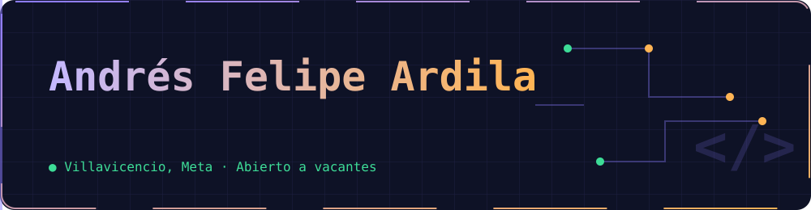
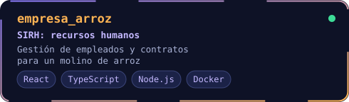
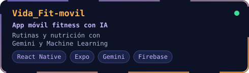
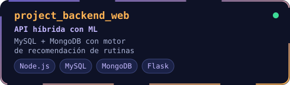
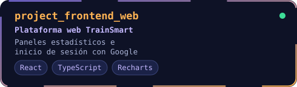
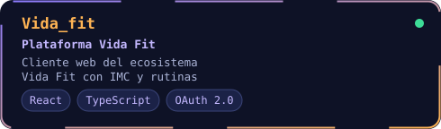
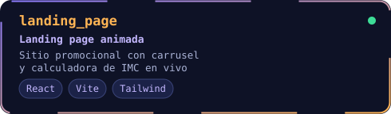

Soy **tecnólogo en Análisis y Desarrollo de Sistemas de Información** y estudiante de **Ingeniería de Sistemas** en Villavicencio, Meta. Construyo aplicaciones web y móviles que conectan datos con inteligencia artificial.

- **Bases de datos:** Técnico Profesional en Operación y Mantenimiento de Bases de Datos
- **IA:** Bootcamp de Inteligencia Artificial, MinTIC y CUN (164 horas)
- **Ahora:** busco mi primera oportunidad en un equipo de desarrollo

## Estadísticas de GitHub

Si tienes una vacante o un proyecto, escríbeme.

