## Sobre mí

Soy tecnólogo en Análisis y Desarrollo de Sistemas de Información y estudiante de Ingeniería de Sistemas en Villavicencio, Meta. Construyo aplicaciones web y móviles que conectan datos con inteligencia artificial.

- Técnico Profesional en Operación y Mantenimiento de Bases de Datos
- Bootcamp de Inteligencia Artificial, MinTIC y CUN (164 horas)
- Busco mi primera oportunidad en un equipo de desarrollo

## Tecnologías

## Proyectos destacados

| Proyecto | Qué hace | Tecnologías |
|---|---|---|
| [**empresa_arroz**](https://github.com/andres23328/empresa_arroz) | Gestión de recursos humanos para un molino de arroz | React, TypeScript, Node.js, Firestore, Docker |
| [**Vida_Fit-movil**](https://github.com/andres23328/Vida_Fit-movil) | App móvil fitness con IA y rutinas por Machine Learning | React Native, Expo, Gemini, Firebase |
| [**project_backend_web**](https://github.com/andres23328/project_backend_web) | API híbrida con motor de recomendación | Node.js, MySQL, MongoDB, Flask |
| [**project_frontend_web**](https://github.com/andres23328/project_frontend_web) | Plataforma web con paneles estadísticos | React, TypeScript, Recharts |
| [**Vida_fit**](https://github.com/andres23328/Vida_fit) | Plataforma web del ecosistema Vida Fit | React, TypeScript, OAuth 2.0 |
| [**landing_page**](https://github.com/andres23328/landing_page) | Sitio promocional animado con calculadora de IMC | React, Vite, Tailwind CSS |

## Actividad

Escríbeme si tienes una vacante o un proyecto.

